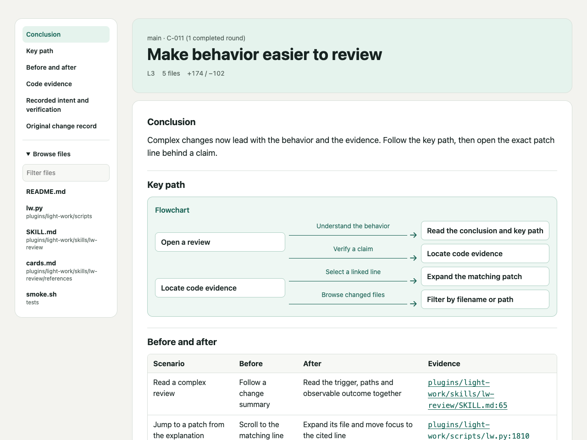

# ai-light-work

English · [简体中文](README.zh-CN.md)

Light Work keeps track of what you asked an AI coding assistant to change and what must still work afterward. It records intent per Git branch, checks the relevant constraints before editing, and gives you a review that explains the behavior and links to the actual diff.

| Plugin | Version | Hosts |
|---|---|---|
| [light-work](plugins/light-work) | 0.6.9 | Claude Code, Codex, and CodeBuddy Code / WorkBuddy |

Requires Python 3.8+ and Git. The plugin works across languages and frameworks and uses the project's own verification commands.



## Install

All three hosts use the same GitHub marketplace and plugin. Your Git client needs access to `fahcode/ai-light-work`.

### Claude Code

Run these commands in Claude Code:

```text
/plugin marketplace add fahcode/ai-light-work
/plugin install light-work@ai-light-work
/reload-plugins
```

From a terminal, use `claude plugin marketplace add fahcode/ai-light-work` and `claude plugin install light-work@ai-light-work`, then start a new session. To update the marketplace, run `/plugin marketplace update ai-light-work` and restart Claude Code.

### Codex

```bash
codex plugin marketplace add fahcode/ai-light-work
```

Open `/plugins` in Codex and install `light-work` from the `ai-light-work` marketplace. Start a new session and trust the plugin's hooks in `/hooks` to enable the automatic workflow. The skills can also be invoked manually.

To update, run `codex plugin marketplace upgrade ai-light-work` and start a new session. Review the hook trust prompt if Codex reports a change to the hooks.

### CodeBuddy Code / WorkBuddy

```bash
codebuddy plugin marketplace add fahcode/ai-light-work
codebuddy plugin install light-work@ai-light-work
```

The repository includes CodeBuddy-compatible manifests. Hook behavior in a live CodeBuddy session remains unverified.

## Daily workflow

| Skill | What it does |
|---|---|
| `lw-record` | Captures intent and testable constraints before an edit. Revisions to the same open intent stay in one entry, with a fresh snapshot for each round. |
| `lw-edit` | Finds the root cause, applies a focused fix, checks affected callers and runs a relevant verification. An edit that clearly conflicts with an established constraint is raised with the user. |
| `lw-review` | Compares the round with its starting snapshot, explains what changed and what still holds, then records a checkpoint. |

Questions and read-only investigations can proceed without a change entry. You control commits and pushes. After a commit, the plugin links it to a reviewed entry when its content matches that entry's checkpoint.

The Review is written for someone taking over the code. It describes the trigger, the before and after path, the observable result, and the evidence. Small changes get a short chat card. Complex behavior gets a diagram when it makes decisions, ordering, state changes, or dependencies easier to follow. L3 and branch reviews link to a self-contained HTML report. The report includes section navigation, a file filter, and links from the explanation or diagram to the scoped Git diff.

## Review and check on demand

| Skill | Use it to |
|---|---|
| `lw-review` | Understand a change, review all recorded work, or prepare a branch merge report. |
| `lw-check` | Look for regressions, conflicting constraints, and gaps in verification. It checks both the intended behavior and a scenario that should keep working. |

Both skills accept the same scope:

| Argument | Scope |
|---|---|
| Omitted | Latest recorded entry |
| `C-xxx` | Completed rounds of that entry |
| `all` or `a` | All recorded completed rounds |
| `branch` or `b` | Full diff from the merge base, including initial development and worktree changes |

In Claude Code, use `/light-work:lw-review` and `/light-work:lw-check`. In Codex, use `$lw-review` and `$lw-check`. For example, `lw-review branch` produces a merge report and `lw-check all` checks recorded changes for overlap and regressions. The editing workflow passes its own starting snapshot and entry ID so its checks stay on the current round.

To trace why a line changed:

```bash
python3 ~/.light-work/lw.py why src/example.py:42
```

## Local data and compatibility

- `.light-work/<branch>.md` holds the branch's change record. The plugin adds this directory to the repository's local Git exclude file.
- `.light-work/<branch>.html` is the latest generated report for the branch. Open it directly from disk.
- `refs/light-work/start/` and `refs/light-work/cp/` retain the starting tree and each completed round. They are local refs.
- New records use English field labels. Existing Chinese records and mixed-language records remain readable. When updating an existing entry, keep its field labels and the language of its content.
- The Stop hook reminds the assistant about unfinished edits and allows the session to end. Shell writes may bypass edit detection. Reference matching and complexity levels are heuristics. Real tests and human review still establish whether the change is ready.

## Development

```bash
bash tests/smoke.sh
claude plugin validate ./plugins/light-work
```

The smoke suite uses temporary Git repositories and a temporary home directory. [Technical design and CLI reference](docs/design.md) describes the record format, hooks, and offline renderer. See the [changelog](CHANGELOG.md) for released changes.

[MIT License](LICENSE)
