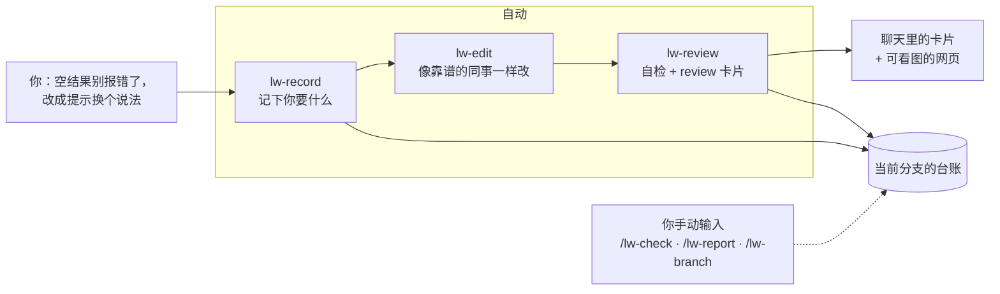

# ai-light-work

让 AI 时代的日常开发**更轻、更稳**。

| 插件 | 版本 | 一句话 |
|---|---|---|
| [light-work](plugins/light-work) | 0.6.1 | 按分支自动维护变更台账：AI 改代码时自动记下你要什么，像靠谱的同事一样做最小改动，改完按复杂度给你看 review 卡片；需要时手动做冲突检查和可视化报告 |

支持 **Claude Code**、**Codex** 和 **CodeBuddy Code / WorkBuddy**，共用同一份插件（同一套技能、钩子和脚本）。只依赖 Python 3.8+ 和 git。


---

## 为什么做这个

我的日常是这样的：一个需求一个分支，功能先用其他工具做完；之后大量时间花在**需求变更和 bugfix** 上，而且往往要沟通好几轮、修好几次。这个阶段全靠 vibe coding，于是有四个反复出现的问题：

1. **改一处坏一处**：这次改的东西，把上次（甚至最开始）定下来的行为改掉了
2. **没时间 review**：AI 写得太多、太快，逐行看代码太花时间
3. **自检要自己描述**：想让 AI 检查一遍，还得自己说清楚查什么、注意什么
4. **AI 改得太多**：顺手重构、改名、"优化"，diff 一大片，真正的改动反而被淹没

## 定位

**轻量是结果，不是目标。** 每个功能都要能对应到上面四个问题中的某一个：对应不上的不做；解决问题必需的，再复杂也要做好。比如用钩子保证"改完必出卡片"、用脚本算条目之间的冲突，这些实现起来不简单，但都是必需的。反过来，凡是会让你多操作一步、多看一屏、多维护一个文件的东西，都要先证明自己值得。

## 需求和功能对照

| 你的需求 | 由什么实现 | 状态 |
|---|---|---|
| 每天自然地记录，不用主动喊 | `lw-record` 自动记录 + 钩子在会话开始、发消息时提醒 | ✓ |
| 一个分支一份，多次沟通、多次修订记成一条 | 台账按分支自动建、自动切换；同一件事的续改合并成同一条的 R2、R3 | ✓ |
| 以后查关联改动、查 bug 要准 | 每条记下用户原话、约束、改了哪些文件、提交号；需求被推翻用 supersedes 串起来 | ✓ |
| AI 用手术刀改代码，写好注释，不过度修改 | `lw-edit` | ✓ |
| 改一个问题不带出其他问题 | 改前给 AI 相关约束；`lw-edit` 查调用方；`lw-review` 逐条自检；脚本用 git grep 找出删掉却还被引用的函数和"不属于本条的改动" | ✓ |
| 和以前定下的事冲突时让我确认，但要轻 | 只在明确冲突时问一句，回个数字就行 | ✓ |
| 每次改完都有适合人看的 review，复杂的给图和关键代码 | `lw-review` 按 L0~L3 输出；钩子保证不漏；L2、L3 同时生成网页 | ✓ |
| 检查时不用我描述查什么 | `/lw-check`：检查清单来自台账，并且能算出条目之间的回退和热点 | ✓ |
| 台账改动的报告：流程图、阅读顺序、风险、测试回归清单 | `/lw-report`（`/lw-report C-xxx` 只看一条） | ✓ |
| 整个分支的汇总 | `/lw-branch`（`/lw-branch pr` 额外给 PR 描述） | ✓ |
| 不用我管文件、状态、配置 | 零配置；每个分支只有 `.light-work/<分支>.md` 一个文件；提交后条目自动定稿 | ✓ |
| 在 CodeBuddy 里能用 | 插件格式兼容 CodeBuddy Code / WorkBuddy | ⚠ 钩子还没在真实会话里验证 |

## 设计目的

| 目的 | 怎么做到 |
|---|---|
| **零负担**：装上就用，不改变你的习惯 | 不需要初始化、配置文件或开关；你照常说话，记录、修改、出卡片都是自动的 |
| **不悄悄改掉已经定下的事** | 每次改动都记下"改完之后应该成立的行为"（约束）；AI 改某个文件前会拿到相关约束，明显冲突时先用一句话问你 |
| **人只看该看的** | 按改动的复杂度决定给你看什么：小改动一行字，大改动才给流程图、阅读顺序和风险 |
| **检查不用你描述** | 检查清单来自台账：有哪些约束、谁和谁改过同一处、哪些还没验证 |
| **像人一样改代码** | 只改该改的、改一处不坏别处、不过度修改、写清楚为什么 |
| **可复现，少靠模型猜** | 分级、约束匹配、影响面、条目之间的冲突，全部由脚本根据 git diff 算出来；模型只负责理解和讲解 |

## 边界：它不做什么

- **不负责从零开发新功能**：适用于功能做完之后的变更和修复阶段，新功能用你已有的工具做
- **不替原始功能凭空写约束**：约束只来自你实际提出的修改。最初做好的功能不会被 AI 推断成一堆约束（推断出来的约束不准，反而会带来误报和多余的提问）；它的安全靠 `lw-edit` 的改前查调用方，以及 `/lw-check 全分支`、`/lw-branch` 的检查
- **不替代测试和人工 review**：它帮你把要看的东西缩小、排好序，并且如实标出哪些没验证；最终判断还是你的
- **不保存完整对话**：台账只存蒸馏后的意图、约束和结论。要追溯原话，去 IDE 的会话记录里找
- **不是团队共享工具**：台账只在你本地（自动加进 `.git/info/exclude`），不会提交，也不会出现在 PR 里
- **不提交、不推送代码**：`git commit` 由你决定，插件只在提交后把提交号回填到台账
- **不在基准分支上记录**：main / master / develop 上不会记账
- **不打断你**：唯一会停下来问你的情况，是改动会推翻一条已经定下来的约束，而你没提到它

---

## 安装

三个工具都从 GitHub 仓库 `fahcode/ai-light-work` 安装，用的是同一份插件。前提：本机有 `git` 和 `python3`（钩子用 `python3` 调脚本）。仓库如果是私有的，本机的 git 要能拉取它（`git clone git@github.com:fahcode/ai-light-work.git` 能成功）。

### Claude Code

在 Claude Code 里依次输入：

```
/plugin marketplace add fahcode/ai-light-work
/plugin install light-work@ai-light-work
/reload-plugins
```

第一条把这个仓库加成插件市场（市场名是 `ai-light-work`），第二条从里面安装 `light-work`，第三条让当前会话加载它（也可以直接重开 Claude Code）。

不想进会话的话，在终端里执行等价的命令：

```bash
claude plugin marketplace add fahcode/ai-light-work
claude plugin install light-work@ai-light-work
```

装好后检查一下：
- 输入 `/plugin`，能看到 `light-work` 已启用
- 输入 `/lw`，补全里有 `/light-work:lw-check`、`/light-work:lw-report`、`/light-work:lw-branch`
- 在任意需求分支上开一个新会话，仓库里会自动出现 `.light-work/<分支>.md`

Claude Code 的插件钩子装好就会运行，不需要额外确认。

更新到最新版：

```
/plugin marketplace update ai-light-work
```

然后重开 Claude Code。

### Codex

```bash
codex plugin marketplace add fahcode/ai-light-work
```

然后打开 Codex，输入 `/plugins`，在 `ai-light-work` 市场里安装 `light-work`。

装完开一个新会话，**输入 `/hooks`，把 light-work 的 5 个钩子设为信任**。Codex 不会运行没被信任的钩子；以后 `hooks/hooks.json` 有改动，也要重新信任一次。不信任的话技能还能用，但自动记录、改前注入约束、改完必出卡片都不会生效。

手动命令在 Codex 里用 `$lw-check`、`$lw-report`、`$lw-branch` 调用（或输入 `/skills` 选）。

更新到最新版：`codex plugin marketplace upgrade ai-light-work`，然后开新会话；如果 `/hooks` 提示钩子有变化，重新信任一次。

### CodeBuddy Code / WorkBuddy

和 Claude Code 一样，把命令里的 `claude` 换成 `codebuddy`：

```bash
codebuddy plugin marketplace add fahcode/ai-light-work
codebuddy plugin install light-work@ai-light-work
```

### 为什么不直接装到通用的 `~/.agents/skills/`

那里只能放技能，放不了钩子，而这个插件靠钩子保证流程不漏；Claude Code 目前也不读这个目录。

**装好就完了。** 在哪个分支上开发就记哪个分支的台账；切到别的分支，自动换成那个分支自己的；切回来，还是原来那份。

---

## 全部功能



### 自动的三步（你不用做任何事）

**`lw-record`：先记下你要什么**
- 在 AI 动手改代码**之前**，把你的原话和意图记成台账里的一条
- 判断这是新需求、同一件事的续改（合并成同一条的第 2、3 轮），还是推翻了以前的需求（新开一条，用 `supersedes` 指向旧条目，旧条目不改）
- 写下"改完之后应该成立的行为"（约束）和 AI 自己做的假设

**`lw-edit`：像靠谱的同事那样改代码**
- **只改该改的**：每一行改动都要能对应到这次的需求，不顺手重构、改名、调格式
- **改一处不坏别处**：改之前看相关约束、`grep` 调用方；修 bug 要在源头修，不在症状处打补丁；不动公开签名和兼容逻辑
- **不过度**：能改一行就不改一个函数，不加用不上的参数和抽象
- **写好注释**：只在"为什么"不明显时写一两行；不写台账编号和 AI 痕迹，不复述代码
- **明显冲突先问**：改动会推翻已有约束而你没提到时，一句话加编号选项，你回个数字就行
  ```
  ⚠ 这次改动和台账冲突，确认一下：
  C-003.1「空字符串返回 reason=empty」→ 这次会变成 reason=fail
    1 按新的改，C-003.1 作废（推荐）  2 保留，空字符串单独处理  3 这处先不动
  ```
- **改完跑一项最便宜的检查**，把实际结果写进台账；同一个问题修到第 3 轮还没好，就停下来换思路

**`lw-review`：自检，然后给你看 review 卡片**
- 用脚本算出这次改动的级别、影响面，以及必须核对的约束
- 逐条核对约束：被自己带坏的当场修好；和新需求冲突的放进"待你拍板"
- 按复杂度输出卡片，最上面三行就是结论：**改了什么、约束还成不成立、需要你做什么**
- L2、L3 带流程图的卡片，同时渲染成网页 `.light-work/<分支>.html`（聊天窗口不一定能显示图）

| 级别 | 什么样的改动 | 卡片内容 |
|---|---|---|
| L0 | ≤10 行，单文件 | 一行 |
| L1 | <50 行，≤3 个文件 | 三行结论 + 一个关键代码片段 |
| L2 | 跨模块 / 改了接口或配置 / 碰到重试、缓存这类关注点 | + 流程图 + 影响面 |
| L3 | ≥200 行 / ≥3 个模块 / 鉴权、支付、迁移等敏感区域 | + 阅读顺序 + 时序图 + 风险 + 建议你亲自看的位置 |

代码片段只取自真实 diff，图只画真实存在的函数。

### 手动的三个命令

| 命令 | 看什么 | 给你什么 |
|---|---|---|
| `/lw-check` | 台账记录的所有改动。参数：`C-xxx` 只看一条，`增量` 只看最近一次，`全分支` 包括最初的功能开发 | 一屏清单：哪次改动改掉了前面的（回退）、哪个函数被多个条目反复改（热点）、哪些约束互相矛盾、哪些没验证、哪些文件改了却不属于任何条目。最后问你要不要修 |
| `/lw-report` | **只看台账改动**（功能完成之后的变更和修复）；`/lw-report C-xxx` 只看这一条，并且展开得更详细 | 改动时间线、改动点流程图、阅读顺序、风险、待拍板、**给测试的回归清单** → `.light-work/<分支>.html` |
| `/lw-branch` | **整个分支**：功能开发 + 后续所有改动 | 整体流程图、阅读顺序、文件清单、风险、**回归清单** → `.light-work/<分支>.html`；`/lw-branch pr` 额外输出可以直接粘贴的 PR 描述 |

调用方式：Claude Code 里是 `/light-work:lw-check`（输入 `/lw` 后从补全里选），Codex 里是 `$lw-check`（或用 `/skills` 选）。

**这三个只能你手动调用，AI 不会自己触发**：Claude Code 靠 `disable-model-invocation`，Codex 靠技能里的 `agents/openai.yaml`（`allow_implicit_invocation: false`）。会自动执行的只有 `lw-record`、`lw-edit`、`lw-review` 这三步。

**查一行代码的来历**（不是命令，修 bug 时 `lw-edit` 会自己用，你也可以直接让 AI 跑）：`python3 ~/.light-work/lw.py why src/a.ts:42` → 这行是哪个提交、哪条台账改动引入的，当时的意图、约束、根因，后来有没有被推翻。还没提交的行，会归到登记了这个文件的 open 条目。

### 背后的钩子（保证流程不漏）

| 时机 | 插件做什么 |
|---|---|
| 会话开始 | 当前分支没有台账就自动建；把工作流和"当前分支状态"摘要告诉 AI |
| 你发消息 | 像是要改代码，就提醒 AI 先记录；同一条改到第 3 轮时，提醒先找根因；会话中途切了分支，自动换台账 |
| AI 编辑某个文件前 | 只把**这个文件相关的**约束告诉 AI，每条只提示一次 |
| AI 准备结束回复 | 改了代码却还没出卡片，就拦下来要求先收尾（同一份改动最多拦两次）。不拦的情况：AI 正在等你回答冲突确认；AI 最后一句是在问你（以问号结尾），说明还没做完，同一份改动只放过这一次，下一轮照样要卡片 |
| 你 `git commit` | 把提交号回填到对应条目，并把它标成已定稿 |

钩子出错不会打断你正常使用 AI，但也不会一直默默失效：错误会记下来，在下一次会话开始或你发消息时，由 AI 用一句话告诉你一次。

---

## 台账长什么样

每个分支一个文件：`.light-work/<分支>.md`（如 `feature/voice` → `feature-voice.md`）。一次改动意图一条，五到十行：

```markdown
### C-004 · 2026-11-19 · bug · settled · 空结果被当成成功
- 意图: 用户："没说话也显示搜索成功" → 空识别结果要返回失败
- 约束:
  - C-004.1 识别结果为空字符串时返回 ok:false reason=empty
  - C-004.2 网络错误仍然进入 error 态
- 假设: 前端用 reason 区分文案
- 根因: 只判了 null，空字符串落到成功分支 voice.ts:2
- 文件: src/search/voice.ts
- 提交: a1b2c3d
- 验证: ✓ pnpm test voice → 16 passed ｜ ✗ 真机未跑
- 关联: supersedes C-003.1
- 过程: R1 判空；R2 用户要求网络错误保留 error 态
- 级别: L1
```

| 字段 | 回答的问题 | 谁写 |
|---|---|---|
| 意图 | 用户当时到底要什么（保留原话关键词，不是 AI 的方案） | AI，改代码前 |
| 约束 | 改完之后哪些行为必须成立：以后改到这些文件都会被核对 | AI，改代码前写、改完修正 |
| 假设 | AI 没得到确认就做的决定：会出现在卡片的"待你拍板"里 | AI |
| 根因 | bug 为什么会发生（只有 bug 才有） | AI，改完 |
| 文件 | 改了哪些文件：约束靠它和代码对上 | AI |
| 提交 | 哪个提交 | 插件，`git commit` 时自动补 |
| 验证 | 做过什么（命令 → 结果）、没做什么。"没验证"永远不会被当成"没问题" | AI，改完 |
| 关联 / 过程 | 推翻了哪条旧需求、这件事来回改了几轮（需要时才有） | AI |
| 级别 | 这次改动的复杂度 | 脚本算 |

### 和 handoff 的区别

台账**不是** handoff，两者解决的问题不一样：

| | handoff（如 situ2001 的 handoff-with-background、mattpocock 的 handoff） | light-work 台账 |
|---|---|---|
| 解决什么 | 上下文快满或换 agent 时，让新会话接着干 | 改了很多轮以后，不把之前定下的事改坏 |
| 形式 | 一份"现在进行到哪了"的快照，按需手动生成，会被更新或重写 | 每次改动追加一条，只追加不重写；需求变了用 supersedes 指向旧条目 |
| 能回答 | 现在做到哪了、下一步做什么 | 第 3 次改动定下了什么约束、为什么这么定、后来被谁推翻了 |

handoff 解决的"接着干"，在这里也有：**每次开新会话时，插件会从台账实时生成一份"当前分支状态"给 AI**，包括有效约束、还没定稿的改动、未验证项和假设。它每次都重新生成，所以不会过期，也不用你手动触发。

另外借鉴了 handoff 里很好的一条原则：**代码说明"实现成了什么样"，用户的话说明"想要什么"**，两者分开记，冲突时记下来让人决定。台账里的 意图（想要什么）、文件和验证（实际改成什么样）、假设和关联（没确认的、被推翻的）就是按这条原则分的。

---

## 数据放在哪

```
你的业务仓库/
  .light-work/                       已自动加进 .git/info/exclude，不会被提交
    feature-voice-search.md          这个分支的台账（每个分支一个文件，就这一份）
    feature-voice-search.html        /lw-report 或 /lw-branch 生成的网页（只有运行命令时才有，每次覆盖）
    fix-login.md                     另一个分支的台账
  .git/refs/light-work/…             台账起点和每次收尾的快照（git 内部对象，不在任何分支上，不会被推送）
```

review 卡片只出现在聊天里，报告直接渲染成网页，都不会留下中间文件。

---

## 参考了哪些开源项目

原则是**适合才用**。这个场景是"后期高频小改动"，前置很重的流程一律不要。

| 项目 | 借鉴了什么 | 没借鉴什么，为什么 |
|---|---|---|
| [forrestchang/andrej-karpathy-skills](https://github.com/forrestchang/andrej-karpathy-skills) | `lw-edit` 的核心：只动该动的、越简单越好、先想清楚、以验证为目标 | 它只是一份常驻准则，不记录也不检查，这正是我们补上的部分 |
| [obra/superpowers](https://github.com/obra/superpowers) | 修 bug 先找根因、修 3 次还不对就停下来；没有证据不算通过 | brainstorming、写计划、强制 TDD 这一整套流程，对每天几十次的小改动太重 |
| [situ2001 handoff-with-background](https://github.com/situ2001/situ2001-plugins/blob/master/skills/handoff-with-background/SKILL.md) | 意图和实现分开记；冲突要记录下来；接手时给一份状态摘要（这里改成了自动生成） | 覆盖式的单份文档：留不下每次改动之间的约束关系 |
| [mattpocock/skills](https://github.com/mattpocock/skills) | 技能分成"模型自动调用"和"用户手动调用"两类 | grill-me（反复追问需求）：平时不打断，只在明确冲突时问一句 |
| [entireio/cli](https://github.com/entireio/cli) | 快照和代码提交分开存，工作分支保持干净 | 保存完整对话记录：太重。两者可以同时装 |
| [thedotmack/claude-mem](https://github.com/thedotmack/claude-mem) | 用钩子渐进式注入：会话开始给摘要，编辑某个文件时才给相关约束 | 向量库和托管服务：黑盒，而且有隐私顾虑 |
| [Fission-AI/OpenSpec](https://github.com/Fission-AI/OpenSpec)、ADR | 需求变了就追加，用 supersedes 表达推翻，不改旧记录 | 先写 proposal、spec、tasks：日常小改动太重 |
| CodeRabbit、puemos/lareview、adversarial-reviewer 等 review 工具 | 用流程图加关键片段讲解改动；按行数、文件数和敏感词分级 | 它们按 PR 粒度、调"审多深"；我们按每次修改、调"给人看什么形态" |

---

## 仓库结构

```
.claude-plugin/marketplace.json      插件市场清单（.codebuddy-plugin/ 下有同一份）
.agents/plugins/marketplace.json     Codex 的插件市场清单
plugins/light-work/
  .claude-plugin/plugin.json         插件清单（.codebuddy-plugin/、.codex-plugin/ 下各有一份，版本号保持一致）
  hooks/hooks.json                   5 个钩子
  scripts/lw.py                      确定性核心（纯标准库）
  skills/lw-record/  lw-edit/  lw-review/     自动
  skills/lw-check/   lw-report/  lw-branch/   手动命令（各带 agents/openai.yaml，Codex 里也不会自动触发）
docs/design.md                       数据格式、分级规则、钩子行为
tests/smoke.sh                       端到端冒烟测试
```

## 开发

```bash
bash tests/smoke.sh                                # 在临时仓库里模拟钩子和技能的完整流程
claude plugin validate ./plugins/light-work        # 校验插件结构
claude --plugin-dir ./plugins/light-work           # 不安装，直接加载本地插件试用（codebuddy 同理）
LW_DEBUG=1 python3 plugins/light-work/scripts/lw.py hook stop < input.json   # 调试单个钩子
```

改了技能或脚本后：跑 `tests/smoke.sh` → 升三份 `plugin.json` 的版本号 → 在 `CHANGELOG.md` 记一笔 → 推送到 GitHub → 按「安装」里的方法在各工具里更新。

## 已知限制

- 钩子按 Claude Code、Codex、CodeBuddy Code 的插件规范编写，冒烟测试模拟了它们的输入输出（包括 Codex 的 `apply_patch`），还需要在真实会话里观察。CodeBuddy **IDE** 是否支持插件钩子需要确认
- 编辑钩子只认编辑工具（Claude 的 Edit/Write、Codex 的 apply_patch）。AI 用 shell 命令（`sed -i`、`cat >`）改文件时不会被标记为"本轮有改动"，Stop 不会拦，`/lw-check` 的"未登记改动"能事后发现
- "在问你就先不拦"只看最后一句是不是问号结尾，客套的"还有别的吗？"也会让卡片推迟到下一轮
- 敏感词和接口变化的检测是启发式的，会有误报；阈值内置在 `scripts/lw.py` 的 `DEFAULTS` 里
- 约束按文件和代码对上。跨文件的影响只做一层：`score` 列出"改了内部逻辑的函数被哪些没改的文件按名字引用"，不追调用链、不做类型分析，同名会误报
- 收尾后如果 merge、rebase 或拉了别人的提交，下一次 `score` 会把这些改动也算进"本轮"，级别可能偏高（不会因此误拦：只有 AI 编辑过文件时 Stop 才会拦）
- 网页里的流程图要联网加载渲染脚本，没网时显示 Markdown 原文

## 路线图

- [ ] 在真实分支上跑一周，校准 L0~L3 阈值、拦截频率和冲突提问的触发率
- [ ] `/lw-check` 支持把检查结果写回条目的「验证」字段
- [ ] 可选接入 Entire CLI：在卡片里附上对应的会话链接

## License

MIT
