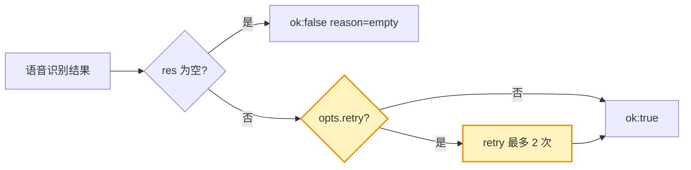
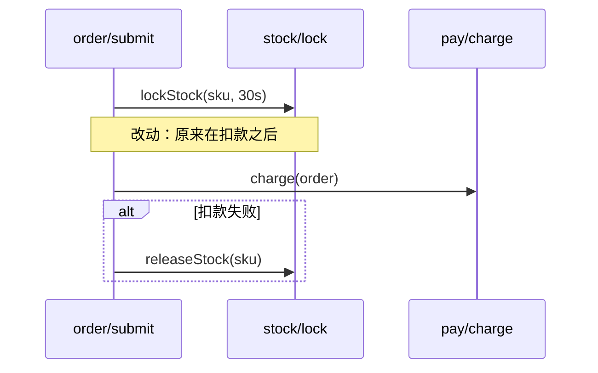

# Review 卡片模板（L0 ~ L3）

分级对应的是"人要花多少力气才能看懂这次改动"，不是"AI 审多深"。AI 侧的约束自检每一级都做。

| 级别 | 典型情况 | 给人看什么 | 目标阅读时间 |
|---|---|---|---|
| L0 | ≤10 行、单文件、无敏感信号 | 一行 | 3 秒 |
| L1 | <50 行、≤3 文件、单模块 | 结论 + 1 个关键片段 | 30 秒 |
| L2 | 50–199 行 / 跨 2 模块 / 改导出或配置 / 关注词 | + 流程图 + 影响面 | 1–2 分钟 |
| L3 | ≥200 行 / ≥3 模块 / 敏感区域 / schema 迁移 | + 阅读路径 + 时序图 + 风险 + 必看位置 | 5 分钟，建议人亲自看代码 |

---

## L0（只在聊天里输出，不落文件）

```
✓ C-007 · L0 · 确认按钮文案 "提交"→"确认"（SubmitBar.tsx:12）· 约束 C-002.1 ✓ · 验证 ✗ 未跑
```

## L1

````markdown
**C-004 · L1 · bug · 空结果不再当成功**
> 改了：`handleResult` 判空时返回 `ok:false, reason:"empty"`
> 约束：C-002.2 ✓ ｜ C-004.1 ✓
> 需要你：确认前端用 `reason` 区分文案（见"待你拍板"）

为什么：测试反馈没说话也显示"搜索成功"。

```diff
// src/search/voice.ts:2
-  if (!res) return { ok: true };
+  if (!res) return { ok: false, reason: "empty" };
```

验证：✓ 手测空输入 ｜ ✗ 真机未跑
待你拍板：前端是否按 `reason` 显示不同文案？（我假设是）
````

## L2

在 L1 基础上增加：**级别依据**（一行，抄 score 的依据）、**流程图**、**影响面**。

````markdown
**C-006 · L2 · change · 语音搜索加重试**
> 改了：`handleResult` 新增 `opts.retry` 分支；`client.get` 超时从 5s 调到 8s
> 约束：C-002.2 ✓ ｜ C-001.1 ✗ legacyFallback 被删 ← 已恢复 ｜ C-004.1 ✓
> 需要你：确认 8s 超时是否和后端约定一致

级别依据：跨 2 个模块（src/search, src/api）· 导出签名变化 · 关注词 retry/timeout



关键片段：
```diff
// src/search/voice.ts:1-4
-export function handleResult(res) {
+export function handleResult(res, opts) {
   if (!res) return { ok: false, reason: "empty" };
+  if (opts && opts.retry) return retry(res);
```

影响面：`handleResult` 签名变化 → 2 处调用（SearchPage.tsx、songOrder/voice.ts），都没传 `opts`，行为不变 ✓
验证：✓ voice.test.ts 18 passed ｜ ✗ 弱网真机未测
待你拍板：超时 8s 是否和后端一致？
````

画图规则：
- 默认 `flowchart`，画**被改函数的分支走向**；跨模块调用顺序重要时用 `sequenceDiagram`。
- ≤12 个节点；节点名用代码里的真实函数名/分支条件。
- 改动的节点或边标 `:::changed`；被删除的路径用虚线 `-.->` 并在标签里写"已删除"。

## L3

在 L2 基础上增加：**阅读路径**、**时序/架构图**、**风险**、**建议你亲自看的位置**、（因规模变 L3 时）**拆分建议**。

````markdown
**C-009 · L3 · change · 下单支付改为先锁库存**
> 改了：下单流程从"先扣款后锁库存"改为"先锁库存、扣款失败回滚"，涉及 order/pay/stock 三个模块
> 约束：C-003.1 ✓ ｜ C-005.1 ? 需要真机验证 ｜ 新增 C-009.1~3
> 需要你：亲自看下面 3 处；确认库存锁超时 30s

级别依据：敏感区域 payment/lock · 跨 3 个模块 · 有效改动 236 行

阅读路径（按这个顺序看，约 5 分钟）：
1. `src/order/submit.ts:40-88` 主流程入口——先看新顺序
2. `src/stock/lock.ts:12-35` 新增锁和超时
3. `src/pay/charge.ts:60-79` 扣款失败分支里的回滚
4. `src/order/submit.test.ts` 新增的 3 个失败场景用例



风险：
- 锁超时（30s）比支付回调慢时库存会被提前释放 → 依据：lock.ts:20 写死 30s
- `charge` 抛异常时没有走 release（已修，见 charge.ts:72）

建议你亲自看：submit.ts:61（回滚条件）、lock.ts:20（超时值）、charge.ts:72（异常分支）
验证：✓ 单测 41 passed ｜ ✗ 支付沙箱未跑 ｜ ✗ 并发场景未测
待你拍板：锁超时 30s？支付沙箱谁来跑？
拆分建议：如果只是因为行数变成 L3，下次可以把"锁库存"和"回滚"拆成两次改动。
````
